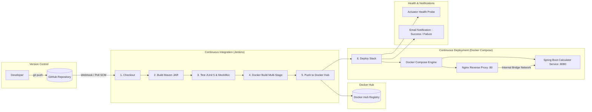

# Calculator REST API — Automated CI/CD Pipeline

[](https://jenkins.io)
[](https://www.docker.com/)
[](https://docs.docker.com/compose/)
[](https://spring.io/projects/spring-boot)
[](https://openjdk.org/)
[]()

> **Course**: CSE 816 — Software Production Engineering  
> **Institution**: International Institute of Information Technology, Bangalore (IIIT-B)  
> **Faculty**: Prof. B. Thangaraju  
> **Project**: End-to-End CI/CD Pipeline for a Calculator REST API (Mini-Project)
> **Docker Hub image**: [`vijayvignesh960/calculator-api`](https://hub.docker.com/r/vijayvignesh960/calculator-api)

---

## 1. System Architecture

The project implements a cloud-native, production-grade microservice architecture orchestrated via Docker Compose and governed by a fully automated declarative Jenkins CI/CD pipeline.



---

## 2. REST API Specification

Base URL: `http://localhost/` (via Nginx Reverse Proxy) or `http://localhost:8081/` (direct container port).

### 2.1 Endpoints Summary

| Operation | HTTP Method | Endpoint | Query Parameters | Expected Response | Error Behavior |
|---|---|---|---|---|---|
| **Add** | `GET` | `/api/v1/add` | `a` (numeric), `b` (numeric) | `{ "operation": "add", "a": 2.0, "b": 3.0, "result": 5.0 }` | HTTP 400 on missing or invalid non-numeric inputs |
| **Subtract** | `GET` | `/api/v1/subtract` | `a` (numeric), `b` (numeric) | `{ "operation": "subtract", "a": 10.0, "b": 4.0, "result": 6.0 }` | HTTP 400 on missing or invalid non-numeric inputs |
| **Multiply** | `GET` | `/api/v1/multiply` | `a` (numeric), `b` (numeric) | `{ "operation": "multiply", "a": 6.0, "b": 7.0, "result": 42.0 }` | HTTP 400 on missing or invalid non-numeric inputs |
| **Divide** | `GET` | `/api/v1/divide` | `a` (numeric), `b` (numeric) | `{ "operation": "divide", "a": 20.0, "b": 4.0, "result": 5.0 }` | **HTTP 400** if `b=0` with structured JSON error |
| **Health Check** | `GET` | `/actuator/health` | _None_ | `{"status":"UP", ...}` | Returns health metrics probe |

All errors share one JSON shape (`timestamp`, `status`, `error`, `message`, `path`):
missing / non-numeric / `NaN` / `Infinity` parameters and overflowing results → **400**, division by zero → **400**, unknown endpoint → **404**.

---

### 2.2 Sample API Invocations & Responses

#### 1. Addition
```bash
curl -s "http://localhost/api/v1/add?a=12.5&b=7.5"
```
**Response (200 OK):**
```json
{
  "operation": "add",
  "a": 12.5,
  "b": 7.5,
  "result": 20.0
}
```

#### 2. Subtraction
```bash
curl -s "http://localhost/api/v1/subtract?a=50&b=18"
```
**Response (200 OK):**
```json
{
  "operation": "subtract",
  "a": 50.0,
  "b": 18.0,
  "result": 32.0
}
```

#### 3. Multiplication
```bash
curl -s "http://localhost/api/v1/multiply?a=6&b=9"
```
**Response (200 OK):**
```json
{
  "operation": "multiply",
  "a": 6.0,
  "b": 9.0,
  "result": 54.0
}
```

#### 4. Division
```bash
curl -s "http://localhost/api/v1/divide?a=100&b=4"
```
**Response (200 OK):**
```json
{
  "operation": "divide",
  "a": 100.0,
  "b": 4.0,
  "result": 25.0
}
```

#### 5. Division by Zero (Validation & Structured Error)
```bash
curl -i "http://localhost/api/v1/divide?a=10&b=0"
```
**Response (HTTP/1.1 400 Bad Request):**
```json
{
  "timestamp": "2026-09-12T08:12:04.391Z",
  "status": 400,
  "error": "Bad Request",
  "message": "Division by zero is not allowed",
  "path": "/api/v1/divide"
}
```

#### 6. Invalid Parameter Type
```bash
curl -i "http://localhost/api/v1/add?a=xyz&b=5"
```
**Response (HTTP/1.1 400 Bad Request):**
```json
{
  "timestamp": "2026-09-12T08:12:04.404Z",
  "status": 400,
  "error": "Bad Request",
  "message": "Invalid parameter 'a': value 'xyz' is not a valid number",
  "path": "/api/v1/add"
}
```

#### 7. Unknown Endpoint
```bash
curl -i "http://localhost/api/v1/power"
```
**Response (HTTP/1.1 404 Not Found):**
```json
{
  "timestamp": "2026-10-10T11:24:04.543Z",
  "status": 404,
  "error": "Not Found",
  "message": "No endpoint found for /api/v1/power",
  "path": "/api/v1/power"
}
```

#### 8. Actuator Health Probe
```bash
curl -s "http://localhost/actuator/health"
```
**Response (200 OK):**
```json
{
  "status": "UP",
  "components": {
    "diskSpace": {
      "status": "UP"
    },
    "ping": {
      "status": "UP"
    }
  }
}
```

---

## 3. Local Development & Testing

### 3.1 Prerequisites
This is a Linux project; on Windows everything runs inside **WSL 2 (Ubuntu 24.04)**:
```bash
sudo apt install -y openjdk-17-jdk maven git docker.io docker-compose-v2
sudo usermod -aG docker $USER      # log out/in afterwards
```

### 3.2 Build the Project
```bash
mvn clean package -DskipTests
```

### 3.3 Execute Tests & Generate Reports
```bash
mvn test
```
All 28 unit tests and Spring MVC `MockMvc` integration tests run automatically. The JUnit XML test reports are generated in:
```
target/surefire-reports/TEST-*.xml
```

---

## 4. Docker Containerization

The project uses a **multi-stage `Dockerfile`** following container security and optimization best practices:
- **Stage 1 (Builder)**: Uses `maven:3.9-eclipse-temurin-17`. Copies `pom.xml` first and runs `mvn dependency:go-offline` to leverage Docker's layer cache for dependencies. Then builds the executable JAR.
- **Stage 2 (Runtime)**: Uses `eclipse-temurin:17-jre-alpine` (~300MB total size).
- **Non-Root Execution**: Creates and runs under dedicated user `appuser` (UID 1001) for security.
- **Health Check**: Native `HEALTHCHECK` checking `/actuator/health`.

### Build Image
```bash
docker build -t vijayvignesh960/calculator-api:latest .
```

### Run Container Standalone
```bash
docker run -d --name calculator-api -p 8080:8080 vijayvignesh960/calculator-api:latest
curl "http://localhost:8080/api/v1/multiply?a=6&b=7"
```

---

## 5. Docker Compose Multi-Container Deployment

The deployment stack includes:
1. **`calculator-api`**: Spring Boot REST service running on port 8080 internally.
2. **`reverse-proxy`**: Nginx web server on port 80 serving as the reverse proxy gateway.
3. **`calculator-net`**: Isolated custom bridge network connecting the two containers.

The Compose project name is pinned (`name: calculator-stack`) so a local run and a Jenkins run manage the same
containers. The API image is `${DOCKER_IMAGE}:${IMAGE_TAG}` (defaults: `vijayvignesh960/calculator-api:latest`);
Jenkins sets `IMAGE_TAG` to the build number. Nginx resolves `calculator-api` through Docker's DNS at request
time, so it keeps routing correctly after the API container is recreated.

### Start Stack
```bash
docker compose up -d --build
./demo.sh            # checks containers, non-root user, every endpoint and error case
```

### Check Container Health Status
```bash
docker compose ps
```

### Stop Stack
```bash
docker compose down
```

---

## 6. Declarative Jenkins CI/CD Pipeline

The `Jenkinsfile` defines a 6-stage declarative pipeline, triggered by a **GitHub webhook** (with Poll SCM every 2 minutes as fallback):

| Stage | Action |
|---|---|
| **1. Checkout** | `checkout scm` of the pushed commit on `main` |
| **2. Build** | `mvn -B clean package -DskipTests` |
| **3. Test** | `mvn -B test`; JUnit XML published with `junit`; any failing test fails the build |
| **4. Docker Build** | `docker.build("vijayvignesh960/calculator-api:${BUILD_NUMBER}")`, also tagged `latest` |
| **5. Push** | `docker.withRegistry('', 'DockerHubCred')` pushes both tags; a failed push fails the build |
| **6. Deploy** | `IMAGE_TAG=${BUILD_NUMBER} docker compose up -d`, then polls `http://localhost/actuator/health` until `UP` |
| **Post** | `emailext` HTML mail to `vijay.vignesh96000@gmail.com` on success and on failure (log attached) |

**Idempotent re-runs**: Deploy never runs `docker compose down`. `up -d` only recreates the containers whose image or
config changed, so Nginx stays up and a re-run of the same commit leaves a healthy stack healthy.

### 6.1 Jenkins Setup (Ubuntu / WSL)
1. **Install** (as in the Jenkins lab):
   ```bash
   sudo curl -fsSL https://pkg.jenkins.io/debian-stable/jenkins.io-2026.key -o /usr/share/keyrings/jenkins-keyring.asc
   echo "deb [signed-by=/usr/share/keyrings/jenkins-keyring.asc] https://pkg.jenkins.io/debian-stable binary/"      | sudo tee /etc/apt/sources.list.d/jenkins.list
   sudo apt update && sudo apt install -y jenkins
   sudo usermod -aG docker jenkins && sudo systemctl enable --now jenkins
   ```
2. **Plugins**: suggested plugins + Docker Pipeline, Email Extension, GitHub, Pipeline Stage View.
3. **Credentials** (`Manage Jenkins → Credentials → Global`) — nothing is hard-coded in the repo:

   | ID | Kind | Used for |
   |---|---|---|
   | `DockerHubCred` | Username + Docker Hub access token (Read & Write) | Push stage |
   | `github-cred` | Username + GitHub token | Cloning the private repository |
   | `github-token` | Secret text | GitHub server config |
   | `github-webhook-secret` | Secret text | Verifying webhook signatures |
   | `gmail-smtp` | Username + Gmail app password | Email notifications |
4. **Email** (`Manage Jenkins → System`): SMTP `smtp.gmail.com`, port `465`, SSL, credentials `gmail-smtp`,
   for both *E-mail Notification* and *Extended E-mail Notification*.
5. **Job**: Pipeline `calculator-devops` → *Pipeline script from SCM* → Git
   `https://github.com/phantomxd960/calculator-devops.git` (credentials `github-cred`), branch `*/main`, script `Jenkinsfile`;
   enable *GitHub hook trigger for GITScm polling*.
6. **Webhook**: Jenkins runs on a laptop, so ngrok exposes it: `ngrok http 8080`. The GitHub webhook points at
   `https://<ngrok-domain>/github-webhook/` (content type JSON, push events, secret = `github-webhook-secret`).

---

## 7. Project Structure

```
calculator-devops/
├── .dockerignore                 # Excludes unneeded files from Docker context
├── .gitignore                    # Git ignore for Maven, IDEs, and secrets
├── Dockerfile                    # Multi-stage Dockerfile (Maven builder + Alpine JRE)
├── Jenkinsfile                   # Declarative CI/CD pipeline (6 stages + email)
├── .gitattributes                # LF line endings for the Linux build
├── demo.sh                       # Live-demo self-check script
├── README.md                     # Complete project documentation
├── REPORT.md                     # Formal project submission report
├── docker-compose.yml            # Multi-container orchestration (App + Nginx)
├── nginx/
│   └── nginx.conf                # Nginx reverse proxy configuration
├── pom.xml                       # Maven configuration with Spring Boot 3 & Actuator
└── src/
    ├── main/
    │   ├── java/com/calculator/
    │   │   ├── CalculatorApplication.java
    │   │   ├── controller/
    │   │   │   └── CalculatorController.java
    │   │   ├── exception/
    │   │   │   ├── DivisionByZeroException.java
    │   │   │   └── GlobalExceptionHandler.java
    │   │   ├── model/
    │   │   │   ├── CalculationResponse.java
    │   │   │   └── ErrorResponse.java
    │   │   └── service/
    │   │       └── CalculatorService.java
    │   └── resources/
    │       └── application.properties
    └── test/
        └── java/com/calculator/
            ├── CalculatorApplicationTests.java
            ├── controller/
            │   └── CalculatorControllerTest.java
            └── service/
                └── CalculatorServiceTest.java
```

---

## 8. Author & Verification

- **Student**: Vijay
- **Email**: `vijay.vignesh96000@gmail.com`
- **Course**: CSE 816 — Software Production Engineering, IIIT Bangalore
