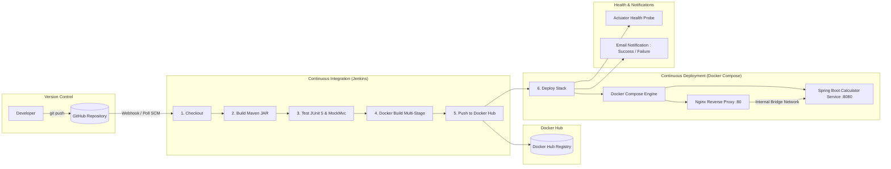

# Calculator REST API — Automated CI/CD Pipeline

[](https://jenkins.io)
[](https://www.docker.com/)
[](https://docs.docker.com/compose/)
[](https://spring.io/projects/spring-boot)
[](https://openjdk.org/)
[]()

> **Course**: CSE 816 — Software Production Engineering  
> **Institution**: International Institute of Information Technology, Bangalore (IIIT-B)  
> **Faculty**: Prof. B. Thangaraju  
> **Project**: End-to-End CI/CD Pipeline for a Calculator REST API (Mini-Project)

---

## 1. System Architecture

The project implements a cloud-native, production-grade microservice architecture orchestrated via Docker Compose and governed by a fully automated declarative Jenkins CI/CD pipeline.



---

## 2. REST API Specification

Base URL: `http://localhost/` (via Nginx Reverse Proxy) or `http://localhost:8081/` (direct container port).

### 2.1 Endpoints Summary

| Operation | HTTP Method | Endpoint | Query Parameters | Expected Response | Error Behavior |
|---|---|---|---|---|---|
| **Add** | `GET` | `/api/v1/add` | `a` (numeric), `b` (numeric) | `{ "operation": "add", "a": 2.0, "b": 3.0, "result": 5.0 }` | HTTP 400 on missing or invalid non-numeric inputs |
| **Subtract** | `GET` | `/api/v1/subtract` | `a` (numeric), `b` (numeric) | `{ "operation": "subtract", "a": 10.0, "b": 4.0, "result": 6.0 }` | HTTP 400 on missing or invalid non-numeric inputs |
| **Multiply** | `GET` | `/api/v1/multiply` | `a` (numeric), `b` (numeric) | `{ "operation": "multiply", "a": 6.0, "b": 7.0, "result": 42.0 }` | HTTP 400 on missing or invalid non-numeric inputs |
| **Divide** | `GET` | `/api/v1/divide` | `a` (numeric), `b` (numeric) | `{ "operation": "divide", "a": 20.0, "b": 4.0, "result": 5.0 }` | **HTTP 400** if `b=0` with structured JSON error |
| **Health Check** | `GET` | `/actuator/health` | _None_ | `{"status":"UP", ...}` | Returns health metrics probe |

---

### 2.2 Sample API Invocations & Responses

#### 1. Addition
```bash
curl -s "http://localhost/api/v1/add?a=12.5&b=7.5"
```
**Response (200 OK):**
```json
{
  "operation": "add",
  "a": 12.5,
  "b": 7.5,
  "result": 20.0
}
```

#### 2. Subtraction
```bash
curl -s "http://localhost/api/v1/subtract?a=50&b=18"
```
**Response (200 OK):**
```json
{
  "operation": "subtract",
  "a": 50.0,
  "b": 18.0,
  "result": 32.0
}
```

#### 3. Multiplication
```bash
curl -s "http://localhost/api/v1/multiply?a=6&b=9"
```
**Response (200 OK):**
```json
{
  "operation": "multiply",
  "a": 6.0,
  "b": 9.0,
  "result": 54.0
}
```

#### 4. Division
```bash
curl -s "http://localhost/api/v1/divide?a=100&b=4"
```
**Response (200 OK):**
```json
{
  "operation": "divide",
  "a": 100.0,
  "b": 4.0,
  "result": 25.0
}
```

#### 5. Division by Zero (Validation & Structured Error)
```bash
curl -i "http://localhost/api/v1/divide?a=10&b=0"
```
**Response (HTTP/1.1 400 Bad Request):**
```json
{
  "timestamp": "2026-09-12T08:12:04.391Z",
  "status": 400,
  "error": "Bad Request",
  "message": "Division by zero is not allowed",
  "path": "/api/v1/divide"
}
```

#### 6. Invalid Parameter Type
```bash
curl -i "http://localhost/api/v1/add?a=xyz&b=5"
```
**Response (HTTP/1.1 400 Bad Request):**
```json
{
  "timestamp": "2026-09-12T08:12:04.404Z",
  "status": 400,
  "error": "Bad Request",
  "message": "Invalid parameter 'a': value 'xyz' is not a valid number",
  "path": "/api/v1/add"
}
```

#### 7. Actuator Health Probe
```bash
curl -s "http://localhost/actuator/health"
```
**Response (200 OK):**
```json
{
  "status": "UP",
  "components": {
    "diskSpace": {
      "status": "UP"
    },
    "ping": {
      "status": "UP"
    }
  }
}
```

---

## 3. Local Development & Testing

### 3.1 Prerequisites
- Java 17+ (JDK)
- Apache Maven 3.9+ (or via Docker)
- Docker & Docker Compose

### 3.2 Build the Project
```bash
mvn clean package -DskipTests
```

### 3.3 Execute Tests & Generate Reports
```bash
mvn clean test
```
All unit tests and Spring MVC `MockMvc` integration tests run automatically. The JUnit XML test reports are generated in:
```
target/surefire-reports/TEST-*.xml
```

---

## 4. Docker Containerization

The project uses a **multi-stage `Dockerfile`** following container security and optimization best practices:
- **Stage 1 (Builder)**: Uses `maven:3.9-eclipse-temurin-17`. Copies `pom.xml` first and runs `mvn dependency:go-offline` to leverage Docker's layer cache for dependencies. Then builds the executable JAR.
- **Stage 2 (Runtime)**: Uses `eclipse-temurin:17-jre-alpine` (~300MB total size).
- **Non-Root Execution**: Creates and runs under dedicated user `appuser` (UID 1001) for security.
- **Health Check**: Native `HEALTHCHECK` checking `/actuator/health`.

### Build Image
```bash
docker build -t calculator-api:1.0.0 -t calculator-api:latest .
```

### Run Container Standalone
```bash
docker run -d --name calculator-api -p 8080:8080 calculator-api:latest
```

---

## 5. Docker Compose Multi-Container Deployment

The deployment stack includes:
1. **`calculator-api`**: Spring Boot REST service running on port 8080 internally.
2. **`reverse-proxy`**: Nginx web server on port 80 serving as the reverse proxy gateway.
3. **`calculator-net`**: Isolated custom bridge network connecting the two containers.

### Start Stack
```bash
docker compose up -d --build
```

### Check Container Health Status
```bash
docker compose ps
```

### Stop Stack
```bash
docker compose down
```

---

## 6. Declarative Jenkins CI/CD Pipeline

The `Jenkinsfile` defines a fully automated, idempotent 6-stage pipeline:

| Stage | Action |
|---|---|
| **1. Checkout** | Pulls latest commit from GitHub upon Webhook trigger or SCM poll |
| **2. Build** | Compiles and packages Spring Boot application using `mvn clean package -DskipTests` |
| **3. Test** | Runs unit & integration tests (`mvn test`), publishes JUnit reports via `junit`, fails build on any test regression |
| **4. Docker Build** | Builds multi-stage Docker image tagged with both `${BUILD_NUMBER}` and `latest` |
| **5. Push** | Authenticates securely to Docker Hub using Jenkins credentials (`docker-hub-credentials`) and pushes images |
| **6. Deploy** | Deploys stack with `docker compose up -d`, polls `/actuator/health` to guarantee zero-downtime healthy release |
| **Post Actions** | Sends rich HTML email notification to `vijay.vignesh96000@gmail.com` on build success or failure |

### Jenkins Configuration Steps:
1. **Install Plugins**:
   - Git Plugin
   - Pipeline Plugin
   - Docker Pipeline
   - Email Extension Plugin (`email-ext`)
2. **Credentials Setup**:
   - Go to `Manage Jenkins` -> `Credentials` -> `System` -> `Global credentials`.
   - Add **Username with password** with ID: `docker-hub-credentials`.
   - Enter your Docker Hub username and access token/password.
3. **Pipeline Job**:
   - Create a **Pipeline** job named `calculator-ci-cd`.
   - Select **Pipeline script from SCM**, choose **Git**, enter your GitHub repo URL, and set script path to `Jenkinsfile`.
   - Enable **GitHub hook trigger for GITScm polling**.

---

## 7. Project Structure

```
calculator-devops/
├── .dockerignore                 # Excludes unneeded files from Docker context
├── .gitignore                    # Git ignore for Maven, IDEs, and secrets
├── Dockerfile                    # Multi-stage Dockerfile (Maven builder + Alpine JRE)
├── Jenkinsfile                   # Declarative CI/CD pipeline (6 stages + email)
├── README.md                     # Complete project documentation
├── REPORT.md                     # Formal project submission report
├── docker-compose.yml            # Multi-container orchestration (App + Nginx)
├── nginx/
│   └── nginx.conf                # Nginx reverse proxy configuration
├── pom.xml                       # Maven configuration with Spring Boot 3 & Actuator
└── src/
    ├── main/
    │   ├── java/com/calculator/
    │   │   ├── CalculatorApplication.java
    │   │   ├── controller/
    │   │   │   └── CalculatorController.java
    │   │   ├── exception/
    │   │   │   ├── DivisionByZeroException.java
    │   │   │   └── GlobalExceptionHandler.java
    │   │   ├── model/
    │   │   │   ├── CalculationResponse.java
    │   │   │   └── ErrorResponse.java
    │   │   └── service/
    │   │       └── CalculatorService.java
    │   └── resources/
    │       └── application.properties
    └── test/
        └── java/com/calculator/
            ├── CalculatorApplicationTests.java
            ├── controller/
            │   └── CalculatorControllerTest.java
            └── service/
                └── CalculatorServiceTest.java
```

---

## 8. Author & Verification

- **Student**: Vijay
- **Email**: `vijay.vignesh96000@gmail.com`
- **Course**: CSE 816 — Software Production Engineering, IIIT Bangalore
